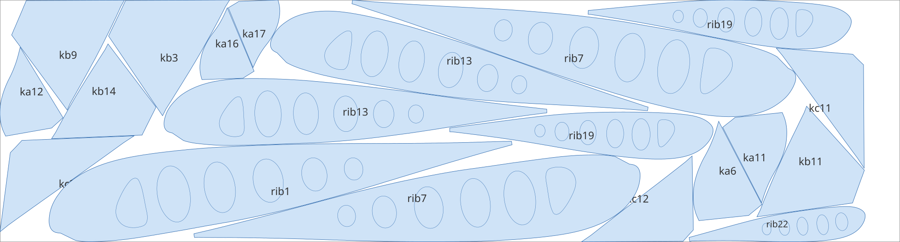
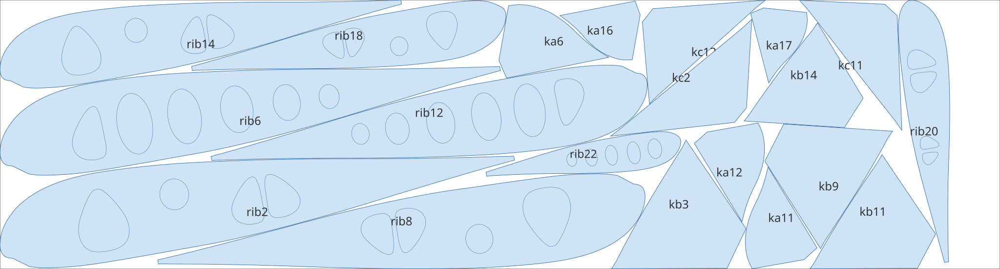
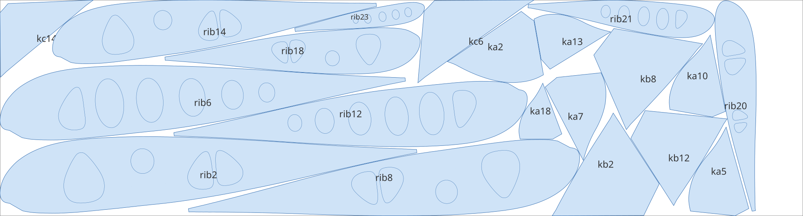
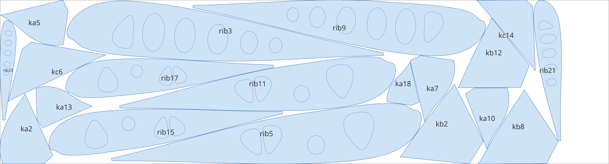
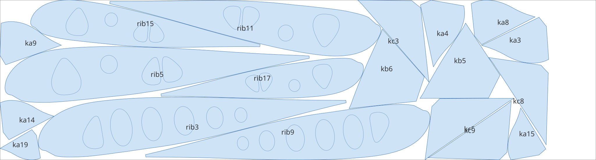
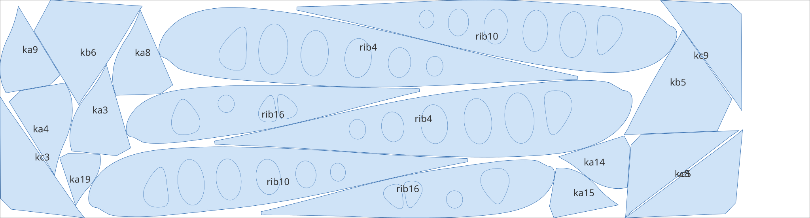
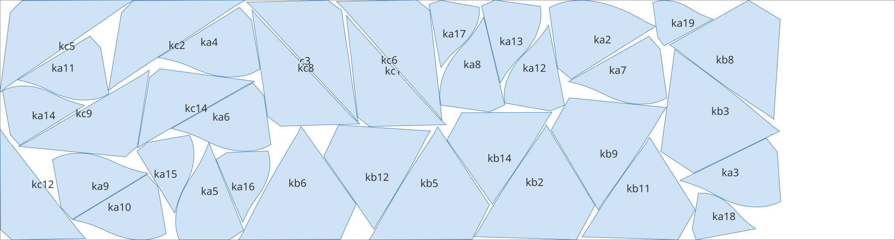
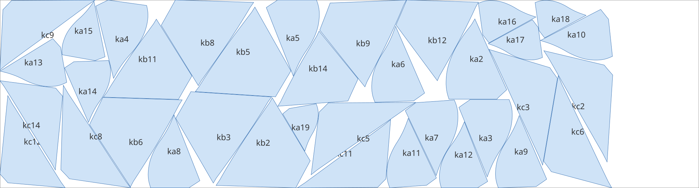
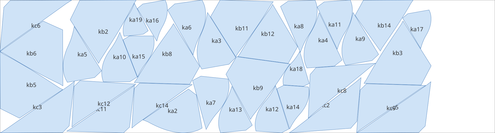
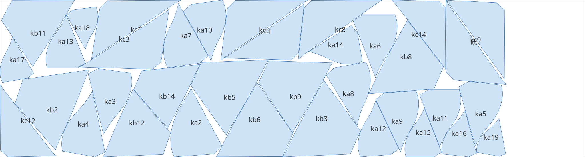

# Examples

Layouts made by `nest run` for a real paraglider: Tayran 6, size 29. Sheet (laser table)
1560 × 5800 mm, gap 3 mm, rotations 0/90/180/270° ± 10° in steps of 2°, 120 s per sheet,
`--drafts 6`. Each layout is the best of 32 seeds on a slurm cluster.

Every folder has the sheets as DXF (parts inserted as blocks of their source drawings, ready for
the laser) and SVG (for viewing), the full `report.txt` and the `command.txt` it was made with.
The input paths in `command.txt` are local to the machine that ran it; the part drawings are not
included.

| folder | contents | parts | sheets | fabric used | utilisation |
|---|---|---|---|---|---|
| [`tayran6_29/one_set`](tayran6_29/one_set) | ribs and the extra parts (`ka`, `kb`, `kc`), one glider | 117 | 6 | 32.551 m | 86.97 % |
| [`tayran6_29/ribs_x2`](tayran6_29/ribs_x2) | ribs only, two gliders | 90 | 9 | 45.974 m | 84.74 % |
| [`tayran6_29/extras_x2`](tayran6_29/extras_x2) | extra parts only, two gliders | 144 | 4 | 20.214 m | 87.39 % |

Ribs are the same on both wing halves, so a set is simply two of each (the centre rib once).
Utilisation is parts area over the used fabric; the lower bound by area for `one_set` is
28.3 m (4.88 sheets).

## One set: ribs and extras

## Extras, two sets

The nine sheets of `ribs_x2` are in [its folder](tayran6_29/ribs_x2).
